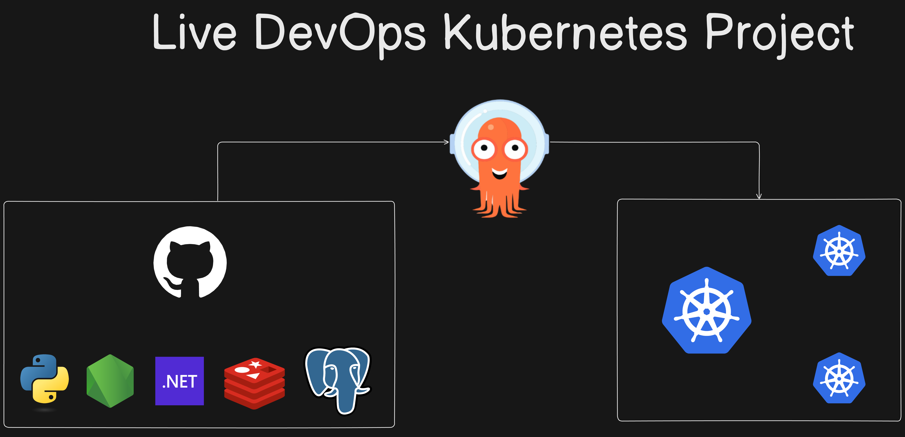
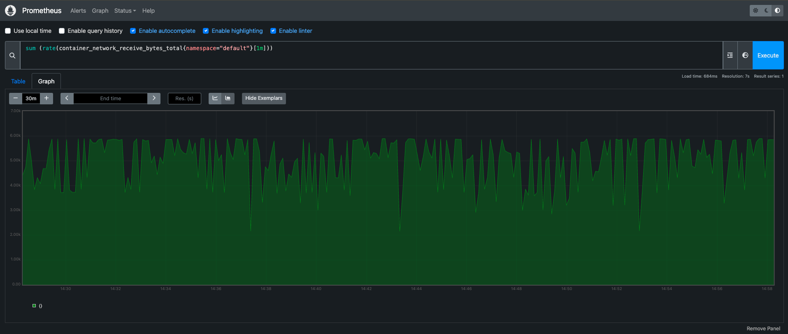
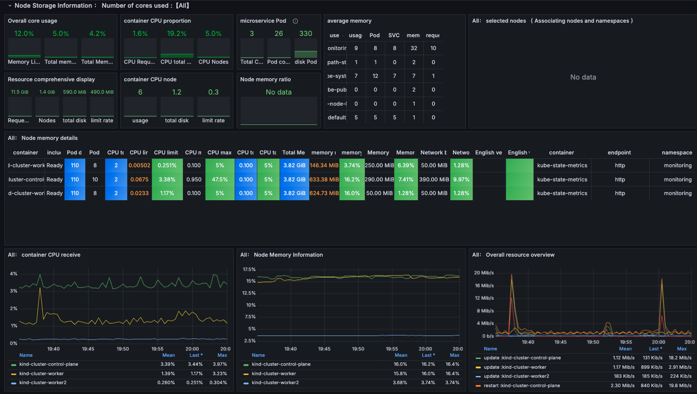

# 🗳️ K8s Kind Voting App

A **cloud-native, microservices-based voting application** deployed on a local Kubernetes cluster using **Kind (Kubernetes IN Docker)**. This project demonstrates real-world Kubernetes patterns including multi-service orchestration, GitOps with Argo CD, and full-stack observability with Prometheus & Grafana — all running on an AWS EC2 instance.



---

## 📌 Table of Contents

- [About the Project](#-about-the-project)
- [Architecture](#-architecture)
- [Tech Stack](#-tech-stack)
- [Project Structure](#-project-structure)
- [How It Works](#-how-it-works)
- [Getting Started](#-getting-started)
- [Running with Docker Compose](#-running-with-docker-compose-local-dev)
- [GitOps with Argo CD](#-gitops-with-argo-cd)
- [Monitoring — Prometheus & Grafana](#-monitoring--prometheus--grafana)
- [Kubernetes Manifests Breakdown](#-kubernetes-manifests-breakdown)
- [Screenshots](#-screenshots)

---

## 📖 About the Project

This project is a hands-on implementation of deploying a **polyglot microservices application** on Kubernetes. The goal was to:

- Understand how Kubernetes manages multi-container workloads
- Set up a local K8s cluster using **Kind** (without needing a managed cloud K8s service)
- Implement **GitOps** principles using **Argo CD** for continuous deployment
- Monitor the cluster and workloads using the **kube-prometheus-stack** (Prometheus + Grafana)

The application is a simple voting app where users vote between two options (e.g. **Cats vs Dogs**), and results are displayed in real-time on a separate results page.

---

## 🏗️ Architecture

```
                        ┌─────────────────────────────────────────────┐
                        │              Kind K8s Cluster                │
                        │                                              │
                        │   ┌──────────┐        ┌──────────────────┐  │
User ──── Port 31002 ──►│   │  Vote    │──────► │      Redis       │  │
                        │   │ (Python) │        │  (Message Queue) │  │
                        │   └──────────┘        └────────┬─────────┘  │
                        │                                │             │
                        │                       ┌────────▼─────────┐  │
                        │                       │     Worker       │  │
                        │                       │    (.NET/C#)     │  │
                        │                       └────────┬─────────┘  │
                        │                                │             │
                        │   ┌──────────┐        ┌────────▼─────────┐  │
User ──── Port 31001 ──►│   │  Result  │◄────── │   PostgreSQL     │  │
                        │   │ (Node.js)│        │     (DB)         │  │
                        │   └──────────┘        └──────────────────┘  │
                        │                                              │
                        └─────────────────────────────────────────────┘
```


### Data Flow

1. **User votes** via the Vote app (Python/Flask) → vote is pushed to **Redis** as a JSON message
2. **Worker** (.NET/C#) continuously pops votes from **Redis** → upserts them into **PostgreSQL**
3. **Result app** (Node.js) polls **PostgreSQL** every second → pushes live scores to the browser via **Socket.IO**

---

## 🛠️ Tech Stack

| Layer | Technology |
|---|---|
| **Vote App** | Python 3, Flask, Gunicorn |
| **Result App** | Node.js, Express, Socket.IO |
| **Worker** | .NET / C# |
| **Message Queue** | Redis (Alpine) |
| **Database** | PostgreSQL 15 (Alpine) |
| **Containerization** | Docker |
| **Orchestration** | Kubernetes (Kind v1.30.0) |
| **GitOps / CD** | Argo CD |
| **Monitoring** | Prometheus + Grafana (kube-prometheus-stack via Helm) |
| **Local Cluster** | Kind (Kubernetes IN Docker) |
| **Cloud Host** | AWS EC2 |

---

## 📁 Project Structure

```
k8s-kind-voting-app/
│
├── vote/                        # Python Flask voting frontend
│   ├── app.py                   # Flask app — handles votes → pushes to Redis
│   ├── Dockerfile
│   └── requirements.txt
│
├── result/                      # Node.js result frontend
│   ├── server.js                # Express + Socket.IO — polls PostgreSQL, streams results
│   ├── Dockerfile
│   └── views/                   # HTML templates
│
├── worker/                      # .NET/C# background worker
│   ├── Program.cs               # Pops from Redis → upserts into PostgreSQL
│   ├── Dockerfile
│   └── Worker.csproj
│
├── k8s-specifications/          # Kubernetes manifests
│   ├── vote-deployment.yaml
│   ├── vote-service.yaml
│   ├── result-deployment.yaml
│   ├── result-service.yaml
│   ├── worker-deployment.yaml
│   ├── redis-deployment.yaml
│   ├── redis-service.yaml
│   ├── db-deployment.yaml
│   └── db-service.yaml
│
├── kind-cluster/                # Kind cluster setup
│   ├── config.yml               # 3-node cluster (1 control-plane + 2 workers)
│   ├── commands.md              # Full command reference
│   ├── install_kind.sh
│   └── install_kubectl.sh
│
├── healthchecks/                # Health check scripts for Redis & PostgreSQL
├── seed-data/                   # Optional: seed votes into the app
├── docker-compose.yml           # Local development (Docker Compose)
├── architecture.excalidraw.png
└── README.md
```

---

## ⚙️ How It Works

### 🐍 Vote App (Python / Flask)
- Runs on port **5000** (NodePort **31002** in K8s)
- Accepts `GET` and `POST` requests
- Assigns a unique `voter_id` cookie to each visitor (prevents duplicate votes per browser)
- On vote submission, serialises `{voter_id, vote}` as JSON and pushes it to the **Redis** `votes` list via `RPUSH`

### ⚙️ Worker (.NET / C#)
- Runs as a **background service** with no exposed port
- Connects to both Redis and PostgreSQL on startup with **auto-retry logic** (handles startup race conditions)
- Continuously polls Redis every **100ms** using `ListLeftPopAsync`
- Performs an **upsert** on the `votes` table — if the voter has voted before, updates their choice
- Handles reconnection for both Redis and PostgreSQL if connections drop

### 🟢 Result App (Node.js / Express)
- Runs on port **4000** (NodePort **31001** in K8s)
- Uses **Socket.IO** for real-time browser updates (no page refresh needed)
- Queries PostgreSQL every **1 second**: `SELECT vote, COUNT(id) FROM votes GROUP BY vote`
- Broadcasts live scores to all connected browser clients via WebSockets

### 🔴 Redis
- Acts as the **message queue** between Vote and Worker
- Uses a simple list pattern: `RPUSH` (Vote) / `LPOP` (Worker)

### 🐘 PostgreSQL
- Stores canonical vote results in a `votes` table
- Schema is **auto-created** by the Worker on first connection:
  ```sql
  CREATE TABLE IF NOT EXISTS votes (
      id   VARCHAR(255) NOT NULL UNIQUE,
      vote VARCHAR(255) NOT NULL
  )
  ```

---

## 🚀 Getting Started

### Prerequisites

- [Docker](https://docs.docker.com/get-docker/) installed and running
- [Kind](https://kind.sigs.k8s.io/docs/user/quick-start/) installed
- [kubectl](https://kubernetes.io/docs/tasks/tools/) installed

### 1. Create the Kind Cluster

```bash
# Navigate to the kind-cluster directory
cd kind-cluster/

# Spin up a 3-node cluster (1 control-plane + 2 workers) on K8s v1.30.0
kind create cluster --config=config.yml

# Verify cluster is up
kubectl cluster-info --context kind-kind
kubectl get nodes
```

### 2. Deploy the Application

```bash
# Apply all Kubernetes manifests at once
kubectl apply -f k8s-specifications/

# Watch all resources come up
kubectl get all

# Wait until all pods are Running
kubectl get pods -w
```

### 3. Access the App

```bash
# Forward Vote app to localhost:5000
kubectl port-forward service/vote 5000:5000 --address=0.0.0.0 &

# Forward Result app to localhost:5001
kubectl port-forward service/result 5001:5001 --address=0.0.0.0 &
```

| Service | URL |
|---|---|
| 🗳️ Vote App | http://localhost:5000 |
| 📊 Result App | http://localhost:5001 |

---

## 🐳 Running with Docker Compose (Local Dev)

For rapid local development without Kubernetes:

```bash
# Build and start all services
docker compose up --build

# Optional: seed the database with random votes
docker compose --profile seed up -d
```

| Service | URL |
|---|---|
| Vote App | http://localhost:5000 |
| Result App | http://localhost:5001 |

---

## 🔄 GitOps with Argo CD

Argo CD implements **GitOps** — the cluster state is always synced from this Git repository. Any change pushed to the repo is automatically applied to the cluster.

```bash
# Create Argo CD namespace
kubectl create namespace argocd

# Install Argo CD
kubectl apply -n argocd -f https://raw.githubusercontent.com/argoproj/argo-cd/stable/manifests/install.yaml

# Expose Argo CD UI
kubectl patch svc argocd-server -n argocd -p '{"spec": {"type": "NodePort"}}'
kubectl port-forward -n argocd service/argocd-server 8443:443 &

# Get the initial admin password
kubectl get secret -n argocd argocd-initial-admin-secret \
  -o jsonpath="{.data.password}" | base64 -d && echo
```

Access the Argo CD UI at: **https://localhost:8443**
Login: `admin` / `<password from above>`

---

## 📈 Monitoring — Prometheus & Grafana

The cluster is fully monitored using the **kube-prometheus-stack** deployed via Helm.

### Install

```bash
# Install Helm
curl -fsSL -o get_helm.sh https://raw.githubusercontent.com/helm/helm/main/scripts/get-helm-3
chmod 700 get_helm.sh && ./get_helm.sh

# Add Prometheus community Helm repo
helm repo add prometheus-community https://prometheus-community.github.io/helm-charts
helm repo update

# Install kube-prometheus-stack into monitoring namespace
kubectl create namespace monitoring
helm install kind-prometheus prometheus-community/kube-prometheus-stack \
  --namespace monitoring \
  --set prometheus.service.nodePort=30000 \
  --set prometheus.service.type=NodePort \
  --set grafana.service.nodePort=31000 \
  --set grafana.service.type=NodePort \
  --set alertmanager.service.nodePort=32000 \
  --set alertmanager.service.type=NodePort

# Port-forward to access UIs
kubectl port-forward svc/kind-prometheus-kube-prome-prometheus -n monitoring 9090:9090 --address=0.0.0.0 &
kubectl port-forward svc/kind-prometheus-grafana -n monitoring 31000:80 --address=0.0.0.0 &
```

| Tool | URL |
|---|---|
| 🔥 Prometheus | http://localhost:9090 |
| 📊 Grafana | http://localhost:31000 |

### Useful PromQL Queries

```promql
# CPU usage across all pods in default namespace (%)
sum(rate(container_cpu_usage_seconds_total{namespace="default"}[1m])) / sum(machine_cpu_cores) * 100

# Memory usage per pod
sum(container_memory_usage_bytes{namespace="default"}) by (pod)

# Network receive bytes per pod (5m rate)
sum(rate(container_network_receive_bytes_total{namespace="default"}[5m])) by (pod)

# Network transmit bytes per pod (5m rate)
sum(rate(container_network_transmit_bytes_total{namespace="default"}[5m])) by (pod)
```

### Monitoring Screenshots





---

## 📜 Kubernetes Manifests Breakdown

All manifests live in [`k8s-specifications/`](./k8s-specifications/).

| Manifest | Kind | Description |
|---|---|---|
| `vote-deployment.yaml` | Deployment | Flask voting frontend (1 replica) |
| `vote-service.yaml` | Service (NodePort 31002) | Exposes Vote on port 5000 |
| `result-deployment.yaml` | Deployment | Node.js result frontend (1 replica) |
| `result-service.yaml` | Service (NodePort 31001) | Exposes Result on port 5001 |
| `worker-deployment.yaml` | Deployment | .NET worker (no external port) |
| `redis-deployment.yaml` | Deployment | Redis message queue |
| `redis-service.yaml` | Service (ClusterIP) | Internal Redis access |
| `db-deployment.yaml` | Deployment | PostgreSQL database |
| `db-service.yaml` | Service (ClusterIP) | Internal DB access |

### Kind Cluster Config

```yaml
# kind-cluster/config.yml
kind: Cluster
apiVersion: kind.x-k8s.io/v1alpha4

nodes:
  - role: control-plane
    image: kindest/node:v1.30.0
  - role: worker
    image: kindest/node:v1.30.0
  - role: worker
    image: kindest/node:v1.30.0
```

---

## 📸 Screenshots

> _Drop your screenshots into the project folder and update the paths below._

<!-- Voting App UI -->
<!--  -->

<!-- Result App UI -->
<!--  -->

<!-- Argo CD Dashboard -->
<!--  -->

<!-- Kubernetes Dashboard -->
<!--  -->

---

## 🧹 Cleanup

```bash
# Delete the Kind cluster (removes all workloads and containers)
kind delete cluster --name=kind
```

---

## 📄 License

This project is licensed under the terms of the [LICENSE](./LICENSE) file.

---

<div align="center">
  <strong>Built with ❤️ using Kubernetes, Docker, Python, Node.js, and .NET</strong>
</div>


